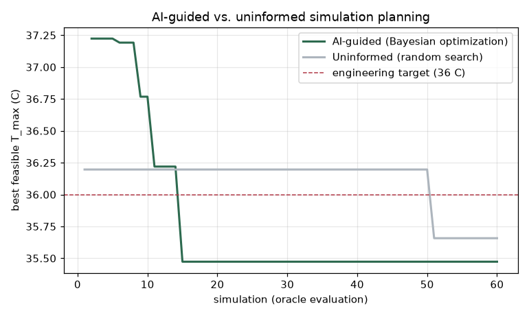

# Planning Simulations with Bayesian Optimization

You're a thermal engineer planning a limited simulation campaign for a cold-plate cooling design. Every simulation is expensive, so you choose which designs to run, and in what order, using an AI-driven strategy (Bayesian optimization) instead of random search. Then you compare the two under the same budget of 60 simulations.



*On the instance shown, Bayesian optimization reached the engineering target in 15 simulations, compared with 51 for random search. The advantage varies by instance: across 20 instances, Bayesian optimization reached the target in 18 and random search in 8. Launch the notebook to run it live and try other instances.*

```{raw} html
<div style="margin-top:1rem;">
  <div id="bo-btn" style="text-align:center;padding:2rem 0 1rem;">
    <button
      onclick="var f=document.getElementById('bo-frame');
               f.setAttribute('src','../lite/notebooks/index.html?path=bo_planning.ipynb');
               document.getElementById('bo-btn').style.display='none';
               f.style.display='block';"
      style="background:#2d6a4f;color:#fff;padding:.75rem 2.5rem;border:none;
             border-radius:.4rem;font-size:1.05rem;font-weight:600;cursor:pointer;
             box-shadow:0 2px 6px rgba(0,0,0,.2);">
      &#x1F680; Launch the notebook
    </button>
    <p style="color:#666;margin:.6rem 0 0;font-size:.85rem;">
      Python runs in your browser via WebAssembly &mdash; no installation needed
    </p>
  </div>
  <iframe id="bo-frame" src="" allow="cross-origin-isolated"
    style="display:none;width:100%;height:calc(100vh - 80px);
           min-height:600px;border:none;">
  </iframe>
</div>
```
